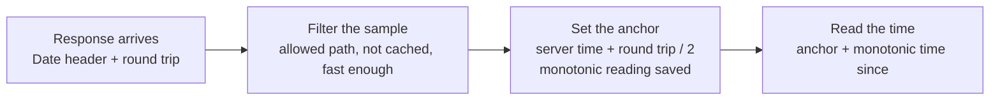

# dio_server_clock

[](https://pub.dev/packages/dio_server_clock)

Tamper-resistant server time for [Dio](https://pub.dev/packages/dio) apps. Reads the HTTP `Date` header from responses you already make and anchors it to a monotonic clock, so device time and timezone changes have no effect.

- **Valid time or no time:** `now` is the server time, or null when it can't be trusted. Never the device clock
- No extra requests and no backend changes
- Keeps counting through deep sleep on Android and iOS
- Corrects for network delay and skips cached responses
- Pure Dart: works in Flutter, CLI and server apps, on Dio 4 and 5

## Why

`DateTime.now()` trusts a clock and a timezone the user controls. If the phone's time is off, changed by hand, or set to another timezone, any time-based decision in the app (market hours, offer windows, cut-off times) is wrong.

## How it works

Every HTTP response carries a `Date` header. The HTTP standard (RFC 9110) requires servers with a clock to send it, and web servers and CDNs (Nginx, Apache, CloudFront, Cloudflare) add it on their own, including on 401 and 500 responses. It is always UTC, with one-second resolution.



The monotonic clock only moves forward and ignores device time and timezone changes, so the time stays correct between samples. Each accepted response replaces the anchor, so the time is as fresh as your latest API call.

## Quick start

```yaml
dependencies:
  dio_server_clock: ^0.2.0
```

```dart
import 'package:dio_server_clock/dio_server_clock.dart';

final serverClock = ServerClock(); // one per backend, app-wide

dio.interceptors.add(ServerClockInterceptor(serverClock)); // add it last

final now = serverClock.now; // DateTime? in UTC; null = no valid time yet
if (now == null) {
  // Show "syncing…" or a neutral state; don't guess.
}
```

## Valid time or no time

`now` returns the server time to within about a second, or **null**. It never falls back to the device clock.

| Situation | `now` |
| --- | --- |
| Before the first accepted response (cold start, offline at launch) | null |
| After `reset()` | null |
| After `invalidate()` where the clock may pause in deep sleep (web, Windows) | null until the next response |
| Otherwise, including after deep sleep on Android and iOS | Server time |

Rules for apps:

- Treat null as **unknown**. Show "syncing…", hide the time-dependent label, or show a neutral state.
- Never replace null with `DateTime.now()` in decision logic. If you need device time for something else (animations, logs), call `DateTime.now()` there directly.
- Use `onSyncChanged` (a `Stream<bool>`) to update the UI when the time arrives or is lost.
- The server stays the final authority: enforce anything that matters there.

What the package can't detect: a server or CDN whose own clock is wrong, and a `Date` header rewritten in transit (for example by a proxy on a rooted device).

## Choosing which requests to sample

Sample authenticated, user-specific responses, which CDNs don't cache (`Cache-Control: private` or `no-store`). Avoid static files and public cacheable endpoints: a cached copy carries an old `Date`.

```dart
ServerClockInterceptor(
  serverClock,
  pathPrefixes: const ['/api/v1/user/', '/api/v1/orders'],
  include: (options) => options.method == 'GET', // optional, combined with pathPrefixes
);
```

Login is a good first sample: it is never cached and happens before any screen that needs the time.

## How samples are chosen

- The **newest** acceptable response wins.
- A response slower than `maxRoundTrip` (2 s) is ignored; without a valid time the limit is `maxRoundTripBeforeSync` (10 s), so a slow network still gets one.
- A response more than `tolerance` (5 s) **ahead** of `now` means the current time was stale: it replaces it at once.
- A response more than `tolerance` **behind** `now` is probably a cached copy: it is ignored. If three in a row agree with each other over more than twice `tolerance`, the server's clock really moved back, and the clock follows it. A cached copy can't do that, because its `Date` doesn't advance.

## Cached responses

A response is skipped when its headers show it came from a cache:

| Header | Treated as cached when |
| --- | --- |
| `Age` | Greater than 0 (`Age: 0` alone is not a hit) |
| `Cache-Status` (RFC 9211) | Any member has the `hit` parameter |
| `X-Cache` | CloudFront `Hit` / `RefreshHit`, Fastly or Varnish `HIT`, Squid `TCP_*_HIT` |
| `CF-Cache-Status` | Cloudflare `HIT`, `STALE`, `UPDATING`, `REVALIDATED` |

`304 Not Modified` responses are skipped too. `isCacheHit(headers)` is exported if you need the same check.

### Local caching interceptors

Add `ServerClockInterceptor` after any caching interceptor. A cache that answers in its `onRequest` (like [dio_cache_plus](https://pub.dev/packages/dio_cache_plus)) never reaches it, and dio_cache_plus 2.1.0+ also marks hits with `Cache-Status` and `Age`, which are detected. For a cache that marks responses another way, pass `isFromCache`:

```dart
ServerClockInterceptor(
  serverClock,
  isFromCache: (response) => response.extra['fromMyCache'] == true,
);
```

### Interceptor order

The round trip is measured from this interceptor's `onRequest` to its `onResponse`. Adding it last keeps slow request work in other interceptors (token refresh, reading secure storage) out of the measurement.

## Sleep and app lifecycle

The time runs on the platform's boot clock, which keeps counting through deep sleep and can't be changed by the user:

| Platform | Clock | Counts deep sleep |
| --- | --- | --- |
| Android, Linux | `clock_gettime(CLOCK_BOOTTIME)` | Yes |
| iOS, macOS | `clock_gettime_nsec_np(CLOCK_MONOTONIC)` | Yes |
| Web, Windows, or if the boot clock fails | `Stopwatch` | No |

`countsSleep` tells you which one is in use. Call `invalidate()` when the app resumes: with a boot clock it does nothing, and without one it clears the time until the next response, because the clock may have paused while the device slept.

```dart
@override
void didChangeAppLifecycleState(AppLifecycleState state) {
  if (state == AppLifecycleState.resumed) serverClock.invalidate();
}
```

The time lives in memory only. A new process starts with no time; nothing is saved to disk, because a stored offset would be wrong after a reboot.

## Accuracy

About ±1 second; a few seconds at worst on slow networks. `uncertainty` gives the worst-case error of the current sample: half the round trip plus half a second for the `Date` header's resolution. `onAnchor` emits a `ClockSample` for each accepted response, with `deviceSkew` (server minus device) for logging or a "your device time is off" banner.

## Fixed offsets

`nowIn(offset)` returns a `DateTime?` whose fields (hour, minute, weekday) are the wall-clock time at that offset. It is still flagged UTC, so read or format its fields, but never store it, send it, or call `toLocal()` on it. Store and send `now!.millisecondsSinceEpoch` instead.

Example: checking market hours in India Standard Time.

```dart
/// True or false, or null when the time is unknown.
bool? isMarketOpen(ServerClock serverClock) {
  final t = serverClock.nowIn(const Duration(hours: 5, minutes: 30));
  if (t == null) return null;
  if (t.weekday == DateTime.saturday || t.weekday == DateTime.sunday) {
    return false;
  }
  final minutes = t.hour * 60 + t.minute;
  return minutes >= 9 * 60 + 15 && minutes < 15 * 60 + 30;
}
```

Fixed offsets don't handle daylight saving time; for regions that use it, convert `now` with a timezone database.

## Web

Browsers hide the `Date` header on cross-origin requests. The server must send `Access-Control-Expose-Headers: Date`. Android, iOS and desktop are unaffected.

## Configuration

| Parameter | Default | Meaning |
| --- | --- | --- |
| `maxRoundTrip` | 2 s | Slower samples are ignored while the clock has a time |
| `maxRoundTripBeforeSync` | 10 s | Looser limit while the clock has no time |
| `tolerance` | 5 s | How far a sample may disagree before it counts as ahead or behind |

## Performance

Nothing runs in the background: no timers, threads or wake-ups, so there is no idle cost. Reading `now` is one monotonic clock read (tens of nanoseconds); each sampled response adds one header parse (about a microsecond). It's safe to read `now` in `build()`.

## Example app

[`example/`](example/) is a Flutter test app for Android and iOS: it shows the server time, device skew and an event log, and has a **Check** button for testing deep sleep on a real device. See [example/README.md](example/README.md).

## FAQ

**Why not NTP?** NTP needs UDP access to a time server, which some networks block, and it gives the time of a third party rather than your server. This package needs nothing beyond the requests you already make.

**Several backends?** Create one `ServerClock` and interceptor per `Dio` instance.

**Can I feed samples myself?** Yes: `addHttpDate(header, roundTrip)` or `addSample(serverTime, roundTrip, resolution: ...)`.
