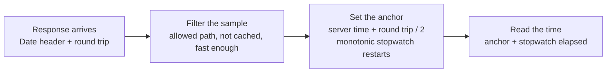

# dio_server_clock

[](https://pub.dev/packages/dio_server_clock)

Tamper-resistant server time for [Dio](https://pub.dev/packages/dio) apps. Reads the HTTP `Date` header from responses you already make and anchors it to a monotonic clock, so device time and timezone changes have no effect.

- No extra requests and no backend changes
- Ignores the device clock and timezone once synced
- Corrects for network delay and skips cached responses
- Pure Dart: works in Flutter, CLI and server apps, on Dio 4 and 5

## Why

`DateTime.now()` trusts a clock and a timezone the user controls. If the phone's time is off, changed by hand, or set to another timezone, any time-based decision in the app (market hours, offer windows, cut-off times) is wrong.

## How it works

Every HTTP response carries a `Date` header. The HTTP standard (RFC 9110) requires servers with a clock to send it, and web servers and CDNs (Nginx, Apache, CloudFront, Cloudflare) add it on their own, including on 401 and 500 responses. It is always UTC, with one-second resolution.



The stopwatch reads the OS monotonic clock, which ignores device time and timezone changes, so the time stays correct between samples. The most precise sample (shortest round trip) is kept, and refreshed after five minutes.

## Quick start

```yaml
dependencies:
  dio_server_clock: ^0.1.0
```

```dart
import 'package:dio_server_clock/dio_server_clock.dart';

final serverClock = ServerClock(); // one per backend, app-wide

dio.interceptors.add(ServerClockInterceptor(serverClock)); // add it last

serverClock.now;                                       // server time, UTC
serverClock.nowIn(const Duration(hours: 5, minutes: 30)); // fields at UTC+5:30
serverClock.isSynced;                                  // false until the first sample
```

Before the first accepted sample, `now` falls back to the device clock. Check `isSynced` where that matters.

## Choosing which requests to sample

Sample authenticated, user-specific responses, which CDNs don't cache (`Cache-Control: private` or `no-store`). Avoid static files and public cacheable endpoints: a cached copy carries an old `Date`.

```dart
ServerClockInterceptor(
  serverClock,
  pathPrefixes: const ['/api/v1/user/', '/api/v1/orders'],
  include: (options) => options.method == 'GET', // optional, combined with pathPrefixes
);
```

Login is a good first sample: it is never cached and happens before any screen that needs the time.

## Cached responses

A response is skipped when its headers show it came from a cache:

| Header | Treated as cached when |
| --- | --- |
| `Age` | Greater than 0 (`Age: 0` alone is not a hit) |
| `Cache-Status` (RFC 9211) | Any member has the `hit` parameter |
| `X-Cache` | CloudFront `Hit` / `RefreshHit`, Fastly or Varnish `HIT`, Squid `TCP_*_HIT` |
| `CF-Cache-Status` | Cloudflare `HIT`, `STALE`, `UPDATING`, `REVALIDATED` |

`304 Not Modified` responses are skipped too. `isCacheHit(headers)` is exported if you need the same check.

### Local caching interceptors

Add `ServerClockInterceptor` after any caching interceptor. A cache that answers in its `onRequest` (like [dio_cache_plus](https://pub.dev/packages/dio_cache_plus)) never reaches it, and dio_cache_plus 2.1.0+ also marks hits with `Cache-Status` and `Age`, which are detected. For a cache that marks responses another way, pass `isFromCache`:

```dart
ServerClockInterceptor(
  serverClock,
  isFromCache: (response) => response.extra['fromMyCache'] == true,
);
```

### Interceptor order

The round trip is measured from this interceptor's `onRequest` to its `onResponse`. Adding it last keeps slow request work in other interceptors (token refresh, reading secure storage) out of the measurement.

## Lifecycle (Flutter)

The monotonic clock can pause while the device is in deep sleep, so after a long sleep `now` can be behind until the next response. Call `invalidate()` when the app resumes so the next response replaces the anchor:

```dart
@override
void didChangeAppLifecycleState(AppLifecycleState state) {
  if (state == AppLifecycleState.resumed) serverClock.invalidate();
}
```

The anchor lives in memory only. A new process starts unsynced; nothing is saved to disk, because a stored offset would be wrong after a reboot.

## Accuracy

About ±1 second. `uncertainty` gives the worst-case error of the current anchor: half the round trip plus half a second for the `Date` header's resolution. `onAnchor` emits a `ClockSample` each time the anchor changes, with `deviceSkew` (server minus device) for logging or a "your device time is off" banner.

This is for client-side decisions. It is not a security boundary: anyone who can rewrite responses (for example a proxy on a rooted device) can change the `Date` header. Enforce anything that matters on the server.

## Fixed offsets

`nowIn(offset)` returns a `DateTime` whose fields (hour, minute, weekday) are the wall-clock time at that offset. It is still flagged UTC, so read or format its fields, but never store it, send it, or call `toLocal()` on it. Store and send `now.millisecondsSinceEpoch` instead.

Example: checking market hours in India Standard Time.

```dart
bool isMarketOpen(ServerClock serverClock) {
  final t = serverClock.nowIn(const Duration(hours: 5, minutes: 30));
  if (t.weekday == DateTime.saturday || t.weekday == DateTime.sunday) {
    return false;
  }
  final minutes = t.hour * 60 + t.minute;
  return minutes >= 9 * 60 + 15 && minutes < 15 * 60 + 30;
}
```

Fixed offsets don't handle daylight saving time; for regions that use it, convert `now` with a timezone database.

## Web

Browsers hide the `Date` header on cross-origin requests. The server must send `Access-Control-Expose-Headers: Date`. Android, iOS and desktop are unaffected.

## Configuration

| Parameter | Default | Meaning |
| --- | --- | --- |
| `maxRoundTrip` | 2 s | Slower samples are ignored once synced |
| `maxRoundTripBeforeSync` | 10 s | Looser limit before the first sample and after `invalidate()` |
| `maxAnchorAge` | 5 min | After this, a less precise sample may replace the anchor |

## FAQ

**Why not NTP?** NTP needs UDP access to a time server, which some networks block, and it gives the time of a third party rather than your server. This package needs nothing beyond the requests you already make.

**Several backends?** Create one `ServerClock` and interceptor per `Dio` instance.

**Can I feed samples myself?** Yes: `addHttpDate(header, roundTrip)` or `addSample(serverTime, roundTrip, resolution: ...)`.
